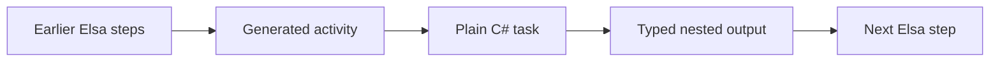

# Elsa task abstraction demos

Real Elsa **3.8.0**, running on .NET 9. No wrapper is written by hand.

Two options are recorded for review; neither is a final design choice.

| Option | Design note | Run |
|---|---|---|
| 1: Generated adapters | [How it works](docs/option-1-generated-adapters.md) | `./run-demo.sh` |
| 2: Dynamic activities | [How it works and compares](docs/option-2-dynamic-activities.md) | `./run-dynamic-demo.sh` |

Option 2 reuses the same plain C# tasks with one shared activity and a provider. It generates no adapter source files. Its results are in [dynamic-demo-output.txt](dynamic-demo-output.txt).

The walkthrough below describes **Option 1**.

## Other demo: Option 3 — Shared RunTask

A second runnable demo uses **one shared activity** and a JSON payload, with no generated adapters. It reuses the same business tasks. Read the [Option 3 walkthrough](docs/option-3-shared-runtask.md).

```bash
./run-shared-demo.sh
```

It runs the invoice and shipment scenarios plus 12 checks. See [its captured output](shared-demo-output.txt).

## Run Option 1

```bash
./run-demo.sh
```

Requires .NET SDK 9 and NuGet access on the first run. The script generates the adapters, then runs the workflows and seven checks. Any failed check exits with an error.

## What to look at

- `src/Demo.Tasks/Tasks.cs`: plain C# tasks and nested data types. **No Elsa package.**
- `src/Demo.Generator/Program.cs`: discovers task contracts and generates Elsa adapters.
- `src/Demo.Elsa/Generated/TaskActivities.g.cs`: generated typed activity inputs and outputs. Do not edit.
- `src/Demo.Elsa/Program.cs`: Elsa flows, input mappings, and runnable checks.
- `demo-output.txt`: captured output from a successful run.



## Scenario 1: Create an invoice

Three built-in Elsa `SetVariable` activities supply customer, order lines, and tax rules. They stand in for API or database results; no external API or database is called.

| Activity input | Source | Shape |
|---|---|---|
| Customer | Earlier customer variable | Customer → BillingAddress → City / PostalCode |
| Lines | Earlier order variable | List of SKU / Quantity / UnitPrice |
| Tax | Earlier tax variable | Rate / Currency |

The generated activity reads those three typed inputs and builds `InvoiceInput`. The task receives ordinary C# objects.

Result: 2 keyboards at ₹1,500 + 1 mouse at ₹500 = ₹3,500. Tax is ₹630. Total is **₹4,130**.

Output includes the customer, address, line list, and totals. This is one typed output with many nested fields.

## Scenario 2: Plan a shipment

The next task uses the invoice output, warehouse data, and a list of packages. Each package has dimensions and a list of SKUs.

| Activity input | Source |
|---|---|
| Invoice | Scenario 1's complete output |
| Origin | Earlier warehouse variable, including its address |
| Packages | Earlier package variable, including dimensions and SKU lists |
| Rules | Input expression: fixed weight limit + signature flag from invoice total |

The rule is defined directly on the activity input:

```csharp
Rules = new(context => new DeliveryRules(
    10m,
    invoice.Get(context)!.Totals.GrandTotal > 4000m))
```

There is **no extra mapping activity**. Whole objects can be passed directly; an input expression can also construct a new object from several sources. Different source types require an explicit expression that builds the expected type.

Result: **2 packages, 3 kg, destination 560001, signature required**. The task checks package SKUs against invoice lines.

## What the checks prove

1. Invoice arithmetic and nested output are correct.
2. Shipment receives the previous nested output and computed rule.
3. Lists and nested dimensions survive the handover.
4. Invalid quantity stops the Elsa flow; its incident records `Lines[1].Quantity`.
5. The invoice task produces the same totals when called without Elsa.
6. Shipment rejects a package with an unknown SKU.
7. A cancelled task stops before doing work.

## Scope and next steps

This is a runtime and code-generation proof, **not a completed consultant-facing Studio extension**.

- The generator exposes each top-level input record field as `Input<T>`, preserving nested types. It generates one typed output per task.
- Flows are authored in C# here. The input lambdas are developer mappings, not saved Studio expressions. This demo does not prove Studio editing, JSON round-tripping, or restart/resume of custom types.
- A friendly nested-field editor still needs Studio work. Typed activity properties alone do not provide that editor.
- The generator supports the demo's public record constructor contracts. Before production, add diagnostics for ambiguous constructors, unsupported types, naming conflicts, and stable activity/task versions. Run generation as a build step in CI.
- Business checks shown here are examples, not complete validation for every null or malformed payload. Add recursive contract validation and publish-time binding checks.
- The invoice ID and source data are fixed examples. There are no writes to a real invoice or shipping service. For real writes, add idempotency before retries, plus persistence and resume tests.
- To change engines, keep `Demo.Tasks`; replace the adapter generator and rebuild flows for the new engine.

Elsa's activity documentation: https://docs.elsaworkflows.io/extensibility/custom-activities
